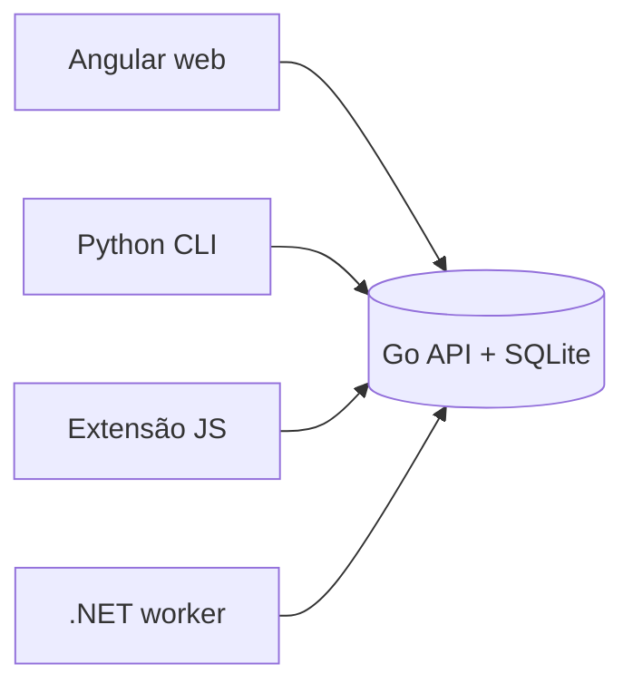

# linkly

Encurtador de links poliglota, construído em **30 dias, 30 minutos por dia**.

Cada parte do sistema usa uma stack diferente, de propósito:

| Pasta | Stack | Papel |
|-------|-------|-------|
| `api/` | **Go** | API REST: cria links, redireciona, conta cliques (SQLite) |
| `cli/` | **Python** | CLI para encurtar, ver estatísticas e exportar relatórios |
| `web/` | **Angular** | Interface web para criar e acompanhar links |
| `checker/` | **.NET** | Worker que verifica periodicamente se os links de destino ainda funcionam |
| `extension/` | **JavaScript** | Extensão de navegador "encurtar esta aba" |



## Progresso

O roteiro completo está em [PLANO.md](PLANO.md) e o diário de bordo em [LOG.md](LOG.md).

- [ ] Semana 1: API em Go
- [ ] Semana 2: CLI e relatórios em Python
- [ ] Semana 3: Frontend em Angular
- [ ] Semana 4: Worker .NET, extensão JS, Docker e CI

## Rotina diária

```bash
./scripts/dia.sh        # mostra a tarefa do dia e abre a entrada no LOG.md
```

1. Rode `./scripts/dia.sh` para ver a tarefa.
2. Trabalhe ~30 minutos.
3. Commit referenciando a issue: `git commit -m "feat(api): health check (closes #1)"`.
4. `git push`.
